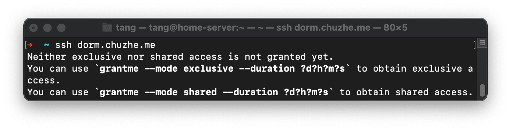
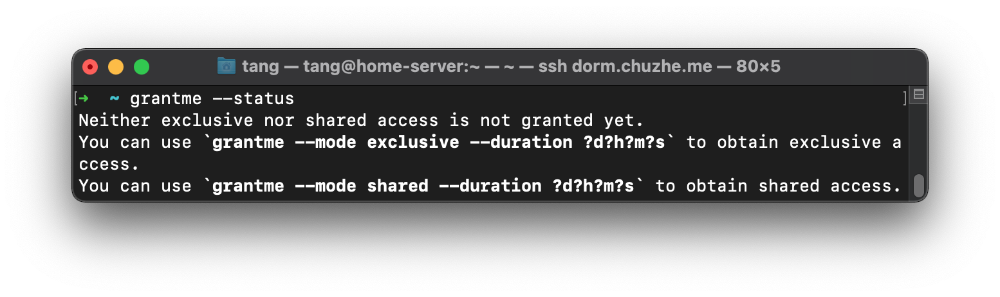
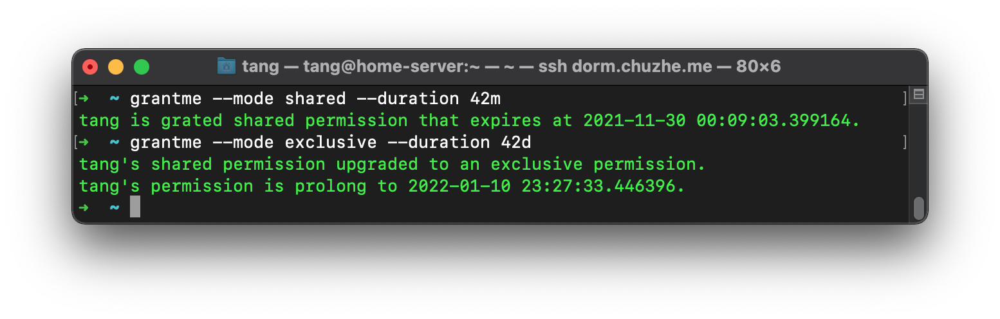

`grantme`是一个用python写的轻量级machine lock manager，用于**取代现有基于微信群的机器使用权限管理方式**。

- [使用方式](#使用方式)
  - [查看当前拿锁状态](#查看当前拿锁状态)
  - [获得共享、独占权限，升级为独占权限，以及延长授权时常](#获得共享独占权限升级为独占权限以及延长授权时常)
  - [放锁](#放锁)
- [安装、更新、删除脚本](#安装更新删除脚本)
- [原理解释](#原理解释)

## 使用方式

### 查看当前拿锁状态

每次登陆服务器机器，shell会自动显示以下消息。

你也可以通过`grantme --status`命令手动查看。

### 获得共享、独占权限，升级为独占权限，以及延长授权时常

你可以通过`grantme --mode {shared,exclusive} [--duration ?d?h?m?s]`获得当前机器一定时间内的使用权限。不指定时常时，默认为30分钟。

如上图所示，当只有本人持有共享权限时，再次调用`grantme --mode exclusive`自动将本人权限升级为独占权限。

如上图所示，在已拥有共享或独占权限时，再次调用`grantme`时，授权时常会被延长。

### 放锁

你可以通过`grantme --revoke`释放自己的共享或独占权限。
管理员可以通过`sudo grantme --revoke --user <USER>`释放指定用户的共享或独占权限。

## 安装、更新、删除脚本

将本仓库clone到任意位置，在仓库根目录下运行`sudo sh install.sh`即可。
该脚本会创建必须的锁信息存放目录（`/var/lib/grantme`），并将`grantme`本体`cp`至`/usr/local/bin/grantme`。

pull本仓库最新commit后，再次运行`sudo sh install.sh`即可覆盖上一版本。

删除`grantme`的痕迹需要手动运行`sudo rm -rf /var/lib/grantme /usr/local/bin/grantme`。

## 原理解释

TODO
