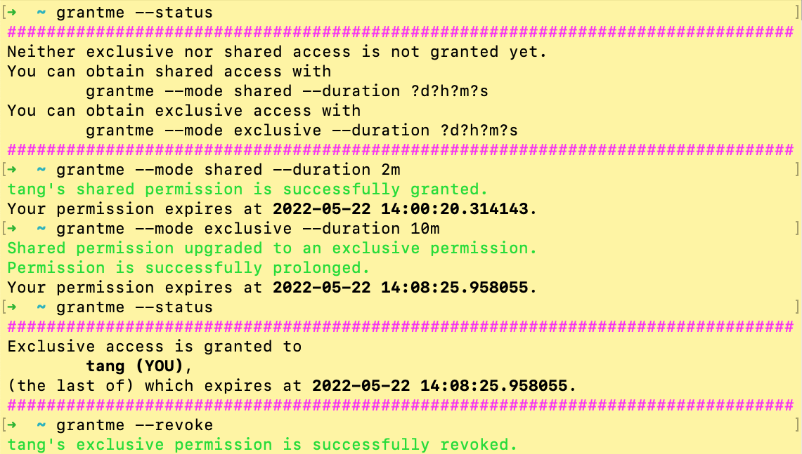

# 轻量级权限管理工具：grantme || Lightweight access management tool: grantme

`grantme`是一个用python写的轻量级机器访问管理命令行工具。它可以授权用户一定时限内的共享访问权限（如，用于debug）和独占访问权限（如，用于性能测试），从而共享同一台机器的用户可以协调机器使用。它是非强制、纯建议性的因为它不能放置恶意用户无视访问权限授权地使用机器。

`grantme` is a lightweight machine access management CLI tool written in Python.
It can grant timed *shared access* (e.g., for debugging) and *exclusive access* (e.g., for performance evaluation) to individual users so that when users of shared machines can coordinate their usage.
It is noncompulsory and purely advisory because it cannot prevent malicious users from ignoring the access granted.

---

- [使用方式 || Usage](#使用方式--usage)
  - [规则 || Rules](#规则--rules)
  - [返回值 || Return values](#返回值--return-values)
  - [依赖 || Requirements](#依赖--requirements)
  - [安装与卸载 || Installation and uninstallation](#安装与卸载--installation-and-uninstallation)
- [参与开发 || Contribute](#参与开发--contribute)
  - [测试 || Testing](#测试--testing)

## 使用方式 || Usage



### 规则 || Rules

1. 当未授权任何访问权限时，用户可任意获取共享或独占全县。

   When no access is granted, users can require either shared or exclusive access.

2. 当已授予共享访问时，未授权用户可获取共享权限。若仅一位用户被授予共享权限，该用户可升级其为独占权限。

   When some shared access is granted, other users can require additional shared access.
   When there is only one user granted with shared access, that user can upgrade his/her access to be exclusive.

3. 当已授予独占访问时，未授权用户不可获取任何权限。

   When exclusive access is granted, other users cannot require any access.

4. 权限在过期后自动失效。已授予权限的用户可提前放弃或延长所持有权限。

   Grated access expires after given duration.
   Users with granted access can early revoke or prolong their access.

### 返回值 || Return values

`grantme`根据操作结果返回相应值。

`grantme` returns values according to operation results.

- 0：成功 || Success
- 6：升级权限失败 || Failed to upgrade access
- 7：获取权限失败 || Failed to obtain access
- 255：其他错误 || Other errors

这些返回值可于集成`grantme`于其他脚本（如，自动化测试）。

These return values can be used for integrating `grantme` into other scripts (e.g., automatic testing).

```shell
#!/bin/bash

grantme --mode exclusive --duration 1h
if [ $? -ne 0 ]
then
    echo "I can't get the lock, cry cry."
    exit 1
fi

# do work

grantme --revoke
```

### 依赖 || Requirements

`grantme`要求Python 3.7级以上版本，无需安装第三方依赖，也无需root权限。

`grantme` requires Python 3.7+, with no third-party dependencies and no root privilege.

### 安装与卸载 || Installation and uninstallation

管理者将本仓库克隆到一个所有用户可读的位置（以下记为`<GRANTME_HOME>`），更新时在该处`git pull`即可，并在每台机器上运行一次`grantme --init`以创建数据库。数据库默认位于`/scratch/grantme`（可用环境变量`GRANTME_DIR`修改），对所有用户开放读写。

The maintainer clones this repository to a location readable by all users (denoted `<GRANTME_HOME>` below), updates it there with `git pull`, and runs `grantme --init` once on each machine to create the database.
The database resides in `/scratch/grantme` by default (configurable via the `GRANTME_DIR` environment variable) and is readable and writable to all users.

```shell
git clone <REPO_URL> <GRANTME_HOME>
<GRANTME_HOME>/bin/grantme --init  # 每台机器一次 || once per machine
```

每位用户在`~/.bashrc`中加入以下内容，以使用`grantme`并在登录时自动打印授权状态：

Each user adds the following to `~/.bashrc` to use `grantme` and automatically print access status upon login:

```shell
export PATH="<GRANTME_HOME>/bin:$PATH"
[ -t 1 ] && grantme --status
```

卸载时删除`<GRANTME_HOME>`、数据目录以及各用户`~/.bashrc`中的对应行：

To uninstall, remove `<GRANTME_HOME>`, the data directory, and the lines in each user's `~/.bashrc`:

```shell
rm -rf <GRANTME_HOME> /scratch/grantme
```

## 参与开发 || Contribute

目前，`grantme`由个人维护。欢迎用户提交缺陷报告和Pull Request。

Currently, `grantme` is maintained by an individual.
Bug reports and pull requests are welcomed.

### 测试 || Testing

在项目根目录下执行以下命令以运行测试。

Execute the following command in the project's root directory to run tests.

```shell
python -m unittest discover
```

增加新功能、修补漏洞后请在`tests`目录下增加或修改相应测试。在所有测试通过后提交Pull Request。

Please add or modify test cases under the `tests` directory when adding new features or fixing bugs.
Make sure all tests have passed before submitting pull requests.
